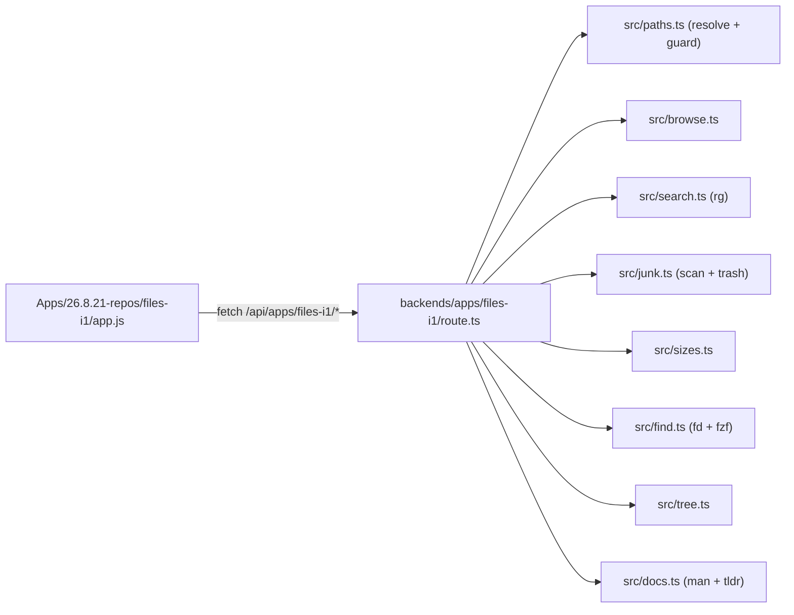

# Files toolkit app (`files-i1`)

## Shape

Follows the `my-repos-v1` pattern exactly: a plain-HTML frontend under `Apps/`, a route module under
`backends/apps/`, one line added to `HANDLERS` in
[backends/routes/router.ts](backends/routes/router.ts).

## Safety layer, written first

`backends/apps/files-i1/src/paths.ts` is the only place that turns a client string into a real path,
and every handler goes through it:

- expand `~`/`$HOME`, `realPathSync` to collapse `..` and symlinks
- refuse anything not under `$HOME`
- refuse a denylist prefix set: `~/Library`, `~/.Trash`, `~/Applications`, `~/.ssh`, `~/.gnupg`, and
  `$HOME` itself as a delete target
- deletes additionally refuse a path that is not one the immediately preceding scan returned

Deleting means moving to macOS Trash, never `Deno.remove`. Implementation:
`run("trash", [...paths])` from the existing
[backends/apps/my-repos-v1/shared/process.ts](backends/apps/my-repos-v1/shared/process.ts) helper,
falling back to `osascript -e 'tell app "Finder" to delete ...'` when `trash` is not on PATH (probed
with the existing `commandExists`). A missing tool surfaces as a UI banner, not a silent permanent
delete.

The `shared/` helpers in `my-repos-v1` (`process.ts`, `fs.ts`, `errors.ts`) get copied into
`backends/apps/files-i1/shared/` rather than imported across apps, matching how the existing apps
stay self-contained.

## Endpoints (`/api/apps/files-i1`)

- `GET /health` — reports which host tools exist (`rg`, `fd`, `fzf`, `tree`, `tldr`, `trash`). The
  UI greys out a tool whose binary is missing and shows the `brew install` line rather than failing
  on click.
- `GET /browse?path=` — one directory level: name, isDir, size, mtime, hidden flag, plus the parent
  path and `$HOME`. This is the folder picker; no recursion.
- `POST /search` — `{ root, query, regex, caseSensitive, glob, hidden, max }` → `rg --json` parsed
  into `{ file, line, column, text }` rows, capped (`--max-count`, hard row limit ~2000). Returns
  `code 127` cleanly when `rg` is absent.
- `POST /scan` — `{ root, kind }` where kind is `ds_store | node_modules | xcode`. Returns
  `{ items: [{path, size, count}], totalSize }`.
  - `ds_store`: every `.DS_Store` file
  - `node_modules`: top-level `node_modules` dirs only, does not descend into a match
  - `xcode`: `~/Library/Developer/Xcode/DerivedData/*`, `~/Library/Developer/Xcode/Archives/*`,
    `~/Library/Developer/CoreSimulator/Caches/*`, `~/Library/Caches/org.swift.swiftpm`, plus
    `.build`/`DerivedData` under the selected root. These sit inside the `~/Library` denylist, so
    `paths.ts` exposes a narrow allowlist used only by this scan kind.
- `POST /trash` — `{ paths: [] }`, each re-validated, returns per-path ok/error.
- `POST /sizes` — `{ root, depth }` → recursive sizes for children, sorted descending, for the space
  analyzer. A `du -sk` shell-out per child is much faster than walking in Deno; fall back to a walk
  if `du` fails.
- `POST /open` — reveal a path in Finder (`open -R`), mirroring `my-repos-v1`'s `open.ts`.

### Tools built on `fd`, `fzf`, `tree`, `man`, `tldr`

- `POST /find` — `{ root, pattern, kind, ext, hidden, depth, changedWithin }` →
  `fd --absolute-path --color=never` with `--type f|d|l`, `--extension`, `--hidden`, `--max-depth`,
  `--changed-within`. Names only, so this is the "find files by name" counterpart to `/search`'s
  content grep. Results feed the same table as the cleanup tools, so any subset can be sent to
  `/trash` or revealed in Finder.
- `POST /fuzzy` — `{ root, query, source }` where `source` is `files | dirs`. Runs `fd` to build the
  candidate list, then filters it with `fzf --filter=<query> --no-sort` — fzf's non-interactive
  mode, since there is no TTY here. Candidates go in on **stdin**, which the copied `process.ts`
  does not support (`stdin: "null"`), so it gains a `run(cmd, args, { input })` option that pipes a
  string in and closes the writer. Empty query returns the unfiltered list. Note `fzf --filter`
  re-runs the whole scan per keystroke, so the UI debounces at ~150ms and the candidate list is
  cached per root for the life of the panel.
- `POST /tree` — `{ root, depth, dirsOnly, hidden }` → `tree -a -L <depth>` (`-d` for dirs only,
  `--noreport` off so the summary line stays). Output is plain text rendered in a `<pre>`; it is the
  quick "what does this folder look like" view and doubles as something to copy into a chat or
  README.
- `GET /doc?command=<name>&source=man|tldr` — command reference, the one tool that ignores the
  selected folder. `man` runs as `man <name> | col -bx` (`MANPAGER=cat`, `MANWIDTH=100`) so the
  output has no backspace-overstrike escapes; `tldr` runs as `tldr --color=never <name>`. The
  command name is validated against `^[A-Za-z0-9._+-]{1,64}$` before it reaches a spawn — it is the
  only free-text value in the app that becomes an argv entry, and `man` will happily take a path.

Long scans stream nothing for v1 — they return whole results with a spinner in the UI. If a scan of
a huge tree proves painful, that becomes a follow-up with SSE.

## Frontend

`Apps/26.8.21-repos/files-i1/` with `_app.yaml`, `index.html`, `app.js`, `styles.css`,
`favicon.svg`, `README.md` (the `script-runner` layout).

- Top bar: current folder path, a Browse button opening the picker modal (list of subfolders,
  breadcrumb, typed-path input, "recent folders" from `localStorage`).
- Left rail of tools, grouped: **Find** (Search, Find files, Fuzzy find, Tree), **Clean**
  (.DS_Store, node_modules, Xcode), **Analyze** (Space), **Reference** (Man / tldr). Adding a tool
  later is one entry in a `TOOLS` array plus one render function, so the "I'll add more later" case
  stays cheap. Each entry carries the binary it needs, which is what the health check greys out
  against.
- The four `fd`/`fzf`/`tree`/docs panels reuse existing pieces rather than growing new layouts: Find
  files and Fuzzy find render into the shared results table, Tree and Man/tldr render into a single
  monospace output pane with a Copy button.
- Cleanup tools share one results table: checkbox per row, path, human size, select-all, a total,
  and a single "Move N items to Trash" button behind a confirm. Nothing is deleted without an
  explicit scan-then-select.
- Space analyzer: horizontal proportional bars per child (largest first) with click-to-descend and a
  breadcrumb back up. Bars, not a real treemap — readable at a glance and no layout library.
- `:root { --accent: ... }` set in `styles.css` and the same hex in `_app.yaml` `color:`, with the
  page background on `body`, per the shell's color sync.

## Registration

1. `_app.yaml`: `appspace: local_Apps`, `sections: ["Files"]`, `icon: lucide:folder-search`,
   `color:` matching `--accent`, `entry: index.html`.
2. Add a `Files` entry to `Apps/sections-metadata.yaml`.
3. Add `handleFiles` to the imports and `HANDLERS` array in
   [backends/routes/router.ts](backends/routes/router.ts).
4. `deno task icons` (new Iconify names), `deno task manifest`, `deno task check`, then restart the
   dev server.

Unit tests for the pure parts, in the style of `backends/apps/script-runner/src/scripts_test.ts`:
`paths_test.ts` for the guard (escapes, symlinks, denylist), `search_test.ts` for `rg --json`
parsing, `find_test.ts` for `fd` argument assembly, and `docs_test.ts` for the command-name
validator (it should reject `../`, spaces, and `-` flags).
